# ESP32 魚塭感測韌體

使用 MicroPython 讀取魚塭水質與環境感測資料，透過 Wi-Fi 將量測、維護與異常紀錄送到後端。裝置內建 Web 管理介面，可設定連線、操作模式與校正參數，並支援部分感測器的繼電器輪流供電。

此倉庫是以根目錄 `main.py` 啟動的既有韌體版本，沒有 `re-esp32/V2` 的隔離板新版內容。硬體腳位、電路與校正結果都需依實際板卡確認，桌面 Python 語法檢查不等於板上功能驗收。

## 目錄

- [量測與運作方式](#量測與運作方式)
- [系統架構](#系統架構)
- [硬體與執行環境](#硬體與執行環境)
- [設定與部署](#設定與部署)
- [校正與操作模式](#校正與操作模式)
- [目錄說明](#目錄說明)
- [驗證與故障排查](#驗證與故障排查)

## 量測與運作方式

| 模組 | 介面與用途 |
|---|---|
| DS18B20 | 淺層與深層水溫，支援校正後讀值 |
| pH | ADC 或 RS485，依 `ph.type` 選擇 |
| 濁度、TDS、EC、ORP | 類比讀值與對應換算 |
| MQ135／MQ137 | 氣體感測器原始資料與校正 |
| 溶氧 | RS485 UART，具有感測器位址、超時與重試設定 |
| MCP3208 | 可選的 SPI 外接 ADC，取代部分板上 ADC 通道 |
| 繼電器輪詢 | ORP、EC、TDS 依序穩定、取樣與供電切換 |

主流程讀取設定、初始化 GPIO／ADC／UART、連線 Wi-Fi、同步時間、取樣與彙整，再以 HTTP 上傳。可用時使用背景傳送佇列，不支援時由同步重試路徑處理。繼電器輪詢可以使用 MAD 篩選異常值，取樣數不足與感測器錯誤需從狀態及日誌判斷。

## 系統架構



可編輯的圖源：[architecture.mmd](docs/architecture.mmd)。圖中的後端是外部 HTTP API，本韌體並未以 MQTT 上傳量測。

## 硬體與執行環境

- 支援這組 `machine.Pin`、ADC、SPI、UART 與 Wi-Fi API 的 ESP32 系列板卡。
- 適合板型的 MicroPython 韌體，並具有 `urequests`、`onewire`、`ds18x20` 等感測與網路依賴。
- 使用對應的 RS485 收發器、感測器電源與共地設計；GPIO 類比輸入不可直接承受超過板卡限制的電壓。
- 使用 MCP3208 或繼電器時，需確認供電、SPI 腳位、接點極性與穩定等待時間。
- 支援 MicroPython 的上傳工具，例如 Thonny；使用自己的序列埠與板卡設定。

以下是**公開範例設定的示例**，不是所有 ESP32 板卡的標準接線：

| 訊號 | 目前設定 |
|---|---|
| DS18B20 淺層／深層 | GPIO 16／17 |
| pH 類比輸入 | GPIO 4，`ph.type=adc` |
| RS485 TX／RX | GPIO 18／21，UART 2、4800 baud |
| RS485 溶氧位址 | 2 |
| RS485 pH 位址 | 3，僅在選用 RS485 pH 時生效 |
| MCP3208 | SPI 2，SCK 12、MOSI 11、MISO 13、CS 14，預設未啟用 |
| ORP／EC／TDS 繼電器 | GPIO 2／1／40，需確認板型具有這些 GPIO |

其他 ADC 腳位及外接 ADC 通道應直接檢查 `config.json` 與板卡原理圖。不同板型不能直接沿用整份設定。

## 設定與部署

### 1. 準備設定

先將 [example.json](example.json) 複製為本機 `config.json`，再填入自己的 Wi-Fi、後端 token 與管理設定。[example.devkit.json](example.devkit.json) 提供另一組板型起點，只有確認接線一致後才可使用。私有 `config.json` 與設定備份不提交。

```powershell
Copy-Item example.json config.json
```

| 設定區塊 | 要確認的項目 |
|---|---|
| `wifi` | 主要與備用 SSID、密碼、靜態 IP、設定 AP |
| `api` | `endpoint`、各 `routes` 路徑與身分設定 |
| `intervals` | 上傳或資料週期 |
| `adc`、`mcp3208` | 參考電壓、SPI 和各通道對應 |
| 各感測器區塊 | 腳位、校正、地址、溫度或環境補償 |
| `relay_cycle` | 啟用狀態、GPIO、有效電位、穩定時間與取樣策略 |
| `web`、`admin` | 管理介面與身分設定 |
| `time`、`watchdog`、`log` | 時間同步、看門狗與日誌行為 |

API 使用 `endpoint` 與路徑組合；[methods/api.py](methods/api.py) 也保留舊 `api.url` 的相容方式。與魚塭後端整合時，確認選用 `/sensors/include` 或 `/sensors/v1/include` 的資料格式，並核對維護與異常回報路徑。

### 2. 上傳完整專案

1. 先安裝適合板型的 MicroPython，確認序列埠 REPL 可以使用。
2. 把根目錄的 `main.py`、`methods/`、`modes/`、`sensors/`、`web/` 與確認過的 `config.json` 上傳到裝置檔案系統根目錄。
3. 確認感測器依賴存在，不要只上傳 `main.py`。
4. 在沒有連接危險負載的情況下重啟，從序列埠檢查 Wi-Fi、GPIO 初始化和量測結果。
5. 再連到管理 Web，逐項校正與測試上傳。

Web 預設設定使用 port `80`、base path `admin`；裝置 IP 以序列埠或 AP 的實際輸出為準。當設定 AP 的密碼不足或加密設定失敗時，程式存在退回開放 AP 的路徑，部署前需檢查實際連線狀態。

## 校正與操作模式

[modes/manager.py](modes/manager.py) 目前從 `web.mode` 選擇模式：

| 模式 | 行為 |
|---|---|
| `normal` | 正常資料上傳，週期來自設定 |
| `dev` | 使用開發讀取／刷新週期，停止正常上傳 |
| `calibration` | 使用校正週期，停止正常上傳 |

pH 支援校正點與電壓換算，溫度支援 offset／scale；MQ、溶氧與其他感測器的校正需依實際模組及管理介面操作。校正模式下繼電器是否保持供電由 `relay_cycle.keep_on_calibration` 決定。

進行 pH、EC 或溶氧校正時，使用適當標準液與等待時間，並記錄溫度、校正時間和模組型號。RS485 共用 UART 時，兩個感測器的通訊參數需一致、位址需不同。

## 目錄說明

| 路徑 | 內容 |
|---|---|
| [main.py](main.py) | 初始化、量測、輪詢、狀態與上傳主流程 |
| [methods](methods) | 設定、Wi-Fi、HTTP 傳送、時間、取樣與日誌 |
| [sensors](sensors) | 各感測器驅動、校正與換算 |
| [modes](modes) | 操作模式選擇 |
| [web](web) | 裝置管理 Web、路由與畫面 |
| [AGENT.md](AGENT.md) | 設定與註解約定 |

## 驗證與故障排查

桌面 Python 可以做語法檢查，但無法直接提供 MicroPython 的 `machine`、`network` 或實際 ADC／UART。完整驗收請逐項確認：

1. 冷啟動的繼電器有效電位與預設狀態符合接線。
2. 每個感測器的原始值、單位與校正後值合理。
3. RS485 不衝突，並能處理拔線、超時與錯誤回應。
4. 正常、開發與校正模式的取樣、刷新和上傳行為符合設定。
5. Wi-Fi 斷線、主要／備用網路切換與設定 AP 可以恢復。
6. 後端收到正確的裝置身分、時間戳與 payload，失敗上傳可在狀態或日誌追查。

| 現象 | 排查順序 |
|---|---|
| 開機缺少設定而報錯 | `config.json` 是否完整、有效且放在裝置根目錄 |
| ADC 讀值固定或飄移 | 供電、共地、分壓、參考電壓和取樣穩定時間 |
| RS485 沒有回應 | A／B 接線、電源、UART、baudrate、位址與共用匯流排參數 |
| HTTP 401／404 | 裝置 token、API base、路徑及資料格式版本 |
| Web 無法連線 | 是否進入 STA 或 AP 模式、裝置 IP、Web 啟用狀態與 port |
| 感測器互相影響 | 輪流供電、穩定等待、MAD 篩選與取樣數 |

請保留每台裝置的校正與接線紀錄。設定檔可能含 Wi-Fi 和 API 憑證，分享或提交前需自行移除私人值；這份 README 不公布現有帳密。

## 專案倉庫

本倉庫：[Du121793/water-quality-sensing](https://github.com/Du121793/water-quality-sensing)。

這個元件屬於魚塭監控與控制系統，各服務獨立部署，透過 API 或設備通訊整合。

| 元件 | 責任 |
|---|---|
| [water-quality-sensing](https://github.com/Du121793/water-quality-sensing) | ESP32 水質感測與量測上傳 |
| [remote-relay-control](https://github.com/Du121793/remote-relay-control) | STM32 遠端繼電器與設備控制 |
| [pond-monitoring-api](https://github.com/Du121793/pond-monitoring-api) | 魚池資料、權限與告警 API |
| [water-quality-rag](https://github.com/Du121793/water-quality-rag) | 水質論文 RAG 與魚池資料問答 |
| 魚塭前端 | 監控介面與管理操作，發布網址待確認 |

## 本機私有設定

公開倉庫只提供範例設定。實際 `.env`、API token、Wi-Fi 密碼、裝置金鑰和私有設定檔保留在本機，範例占位值必須換成自己的設定才能使用相應服務。
